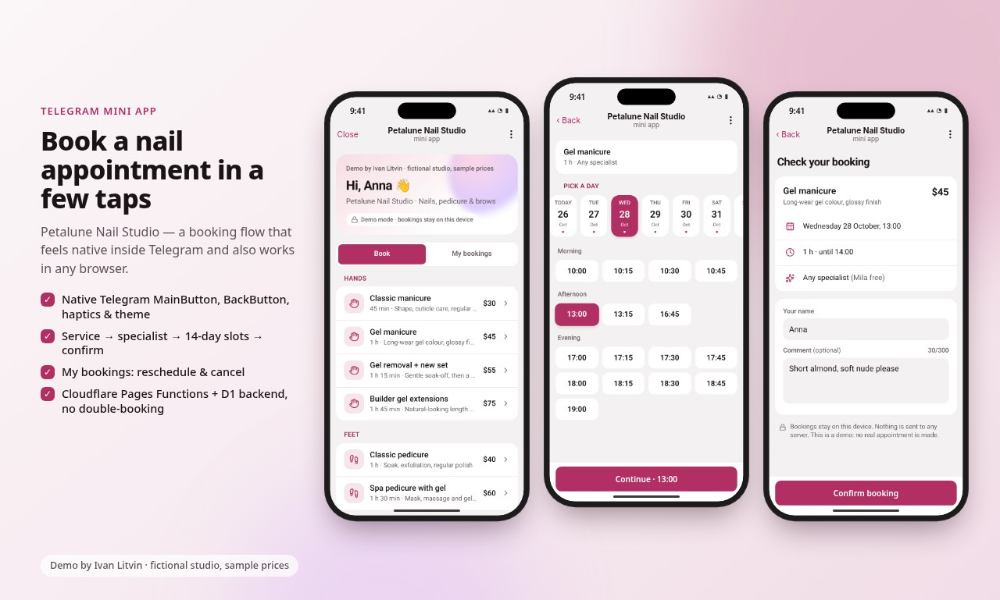
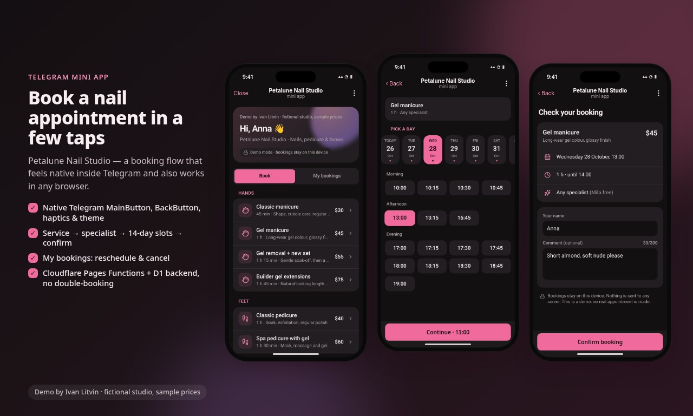
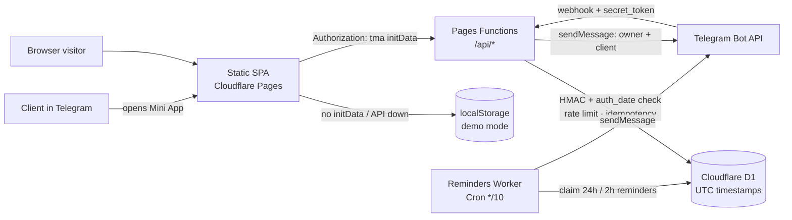

# Petalune Nail Studio — Telegram Mini App booking demo

> **Demo by Ivan Litvin · fictional studio, sample prices.** Petalune is not a real business: no real address,
> phone, reviews or ratings. The public demo runs in **demo mode** — bookings live in `localStorage`, nothing is sent to a server.

**Live demo:** https://tg-booking-miniapp.pages.dev (in a browser, demo mode) · Telegram bot: [t.me/KaaaaniBot](https://t.me/KaaaaniBot)

 

A Telegram Mini App (also works as a normal web page) for booking nail appointments:
service → specialist (or "any") → 14‑day date strip with free slots → confirm (optional comment) → success.
"My bookings" supports cancel and reschedule; a "Studio admin demo" toggle adds a day schedule, time blocking and no‑show marking.

**Stack:** Vite · React 19 · TypeScript · Tailwind CSS 4 · official `telegram-web-app.js` ·
Cloudflare Pages Functions + D1 (SQLite) · Cloudflare Worker with Cron Triggers · Playwright · axe · Lighthouse.

## Features

- **Native Telegram feel:** `themeParams` + live `themeChanged`, MainButton / BackButton, HapticFeedback, `expand()`,
  safe‑area & content‑safe‑area insets, header/background colours, greeting by first name (`Guest` otherwise).
- **Browser mode:** in‑page header, Back and bottom action button, light/dark toggle, respects `prefers-reduced-motion`.
- **Slots:** generated in the studio time zone (`Europe/Berlin` in config), stored as UTC; no overlaps (service duration +
  buffer), past slots and slots inside the minimum notice are hidden.
- **Two data modes behind one interface** (`src/data`):
  - `demo` — localStorage with seeded busy slots; used automatically when there is no Telegram `initData`, when `/api/health`
    is unreachable, or with `?mode=demo`.
  - `api` — Pages Functions + D1; optimistic UI with conflict handling (409 → slot list refresh + notice).
- **Backend:** initData HMAC validation + `auth_date` freshness, admin allowlist (`ADMIN_IDS`), per‑user rate limiting,
  idempotency keys on every write, DB‑level double‑booking protection (triggers + partial unique index),
  bot webhook with `secret_token` check (`/start` → Mini App button; owner + client notifications),
  reminders Worker (Cron every 10 min, 24 h and 2 h reminders, idempotent claims).

## Architecture



## Configuration — one file

Everything studio‑specific lives in **`shared/config.ts`**: name, time zone, currency, services (duration, buffer, sample price),
staff and their days off, opening hours, slot step, minimum notice, booking horizon (14 days) and the demo seed.
After editing services/staff, regenerate the D1 seed migration:

```bash
node scripts/gen-seed.mjs        # rewrites migrations/0002_seed_catalog.sql
```

## API (Pages Functions, `functions/api/[[path]].ts`)

| Method | Path | Notes |
|---|---|---|
| GET | `/api/health` | mode probe |
| GET | `/api/me`, `/api/catalog`, `/api/availability?serviceId=&staffId=&from=&days=` | auth via `Authorization: tma <initData>` |
| GET/POST | `/api/bookings` | list my bookings / create (`Idempotency-Key` required) |
| POST | `/api/bookings/:id/cancel`, `/api/bookings/:id/reschedule` | own bookings only, idempotent |
| GET | `/api/admin/schedule?date=`, `/api/admin/upcoming` | `ADMIN_IDS` only |
| POST/DELETE | `/api/admin/time-off[/:id]` | block / unblock time |
| POST | `/api/admin/bookings/:id/no-show` | past bookings only |
| POST | `/api/telegram/webhook` | requires `X-Telegram-Bot-Api-Secret-Token` |

## Local development (no Cloudflare account, no real token)

```bash
npm ci
npm run dev                       # frontend only, demo mode → http://localhost:5173
cp .dev.vars.example .dev.vars    # FAKE token, local Bot API stub
npm run dev:api                   # build + local D1 migrations + wrangler pages dev on :8788
```

`.dev.vars` is git‑ignored. Never put a real token in the repo.

## Tests

| Command | What it checks |
|---|---|
| `npm run test:api` | local D1 + `wrangler pages dev` + Bot API stub + fake‑token initData: auth (missing/forged/tampered/expired), availability, create/idempotency, 10 parallel bookings → exactly one wins, DB triggers, cancel/reschedule, admin allowlist, rate limiting, webhook secret, `/start`, reminders Worker (24 h / 2 h, once) |
| `npm run test:e2e` | (needs `npm run preview`) full flow, no double‑booking, cancel & reschedule, past slots hidden, fake Telegram theme switching, MainButton/BackButton/haptics, fallback to demo mode, admin toggle, 320/390 px layout, reduced motion, zero third‑party requests |
| `npm run test:e2e-api` | UI in API mode against local Pages + D1: booking stored, rival‑booking conflict notice, admin Studio tab |
| `npm run test:a11y` | axe on every screen, mobile + desktop, light + dark |
| `npm run test:lighthouse` | Lighthouse mobile (perf / a11y / best practices / SEO) |

Tests use a system Chrome (`/usr/bin/google-chrome`) via `playwright-core`; adjust paths in `tests/*.mjs` on other machines.

## Static demo deploy (demo mode only)

The build output in `dist/` is a plain static site:

```bash
npm ci && npm run build
cd dist && npx wrangler pages deploy . --project-name tg-booking-miniapp   # run inside dist/, so functions/ is NOT uploaded
```

Without Functions the app always falls back to demo mode. Site URL: <https://tg-booking-miniapp.pages.dev>.

## Production setup (full stack) — **steps marked 👤 are Ivan's** (need his accounts)

All on Cloudflare **free** tiers (Pages, Functions/Workers 100k req/day, D1 5 GB, Cron Triggers) and the free Telegram Bot API.

1. 👤 **BotFather** (Telegram): `/newbot` → choose name + username → copy the token (keep it secret).
2. 👤 `npx wrangler login` (Cloudflare account).
3. 👤 `npx wrangler d1 create tg-booking-db` → paste the `database_id` into **both** `wrangler.toml` and `workers/reminders/wrangler.toml`.
4. 👤 `npx wrangler d1 migrations apply tg-booking-db --remote`
5. 👤 Create the Pages project once: `npx wrangler pages project create tg-booking-miniapp --production-branch main`
6. 👤 Secrets (values never committed):
   ```bash
   npx wrangler pages secret put BOT_TOKEN       --project-name tg-booking-miniapp
   npx wrangler pages secret put WEBHOOK_SECRET  --project-name tg-booking-miniapp   # long random string, [A-Za-z0-9_-]
   npx wrangler pages secret put ADMIN_IDS       --project-name tg-booking-miniapp   # comma-separated Telegram user ids
   npx wrangler pages secret put OWNER_CHAT_ID   --project-name tg-booking-miniapp   # owner's chat id for notifications
   ```
   Check `MINI_APP_URL` in `wrangler.toml` `[vars]` matches the real Pages URL.
7. 👤 Deploy frontend + Functions from the **project root** (so `functions/` is bundled):
   `npm run build && npx wrangler pages deploy dist --project-name tg-booking-miniapp`
8. 👤 Reminders Worker: `cd workers/reminders && npx wrangler secret put BOT_TOKEN && npx wrangler deploy`
9. 👤 Register the webhook (once; replace the placeholders, run locally — do not commit):
   ```bash
   curl -X POST "https://api.telegram.org/bot<TOKEN>/setWebhook" \
     -d "url=https://tg-booking-miniapp.pages.dev/api/telegram/webhook" \
     -d "secret_token=<WEBHOOK_SECRET>" -d 'allowed_updates=["message"]'
   ```
10. 👤 BotFather → `/mybots` → bot → **Bot Settings → Menu Button** → URL `https://tg-booking-miniapp.pages.dev`
    (optionally **Configure Mini App** / `/newapp` for a `t.me/<bot>/<app>` direct link).
11. 👤 Smoke test: send `/start` to the bot → tap **Book an appointment** → book → owner gets a notification.
    Clients get confirmations/reminders only after they have pressed `/start` (Telegram rule).

Free‑tier notes: Cron runs every 10 min (≈4.3k invocations/month); rate limiting and idempotency are stored in D1, so no paid KV/Durable Objects are needed.

## Project layout

```
shared/        config.ts (the one config), slot engine, time-zone helpers, DTO types
src/           React app: telegram/ (WebApp bridge), data/ (demo + api repositories), screens/
functions/     Pages Functions: api router, initData auth, rate limit, idempotency, webhook, Bot API client
migrations/    0001_init.sql (schema, triggers, unique index), 0002_seed_catalog.sql (generated)
workers/       reminders Worker (Cron)
tests/         api, e2e, e2e-api, a11y, lighthouse, fake Telegram, Bot API stub
scripts/       postbuild (CSP/_headers/sitemap), gen-seed, shots, video
```

## License

[MIT](LICENSE) © 2026 Ivan Litvin
